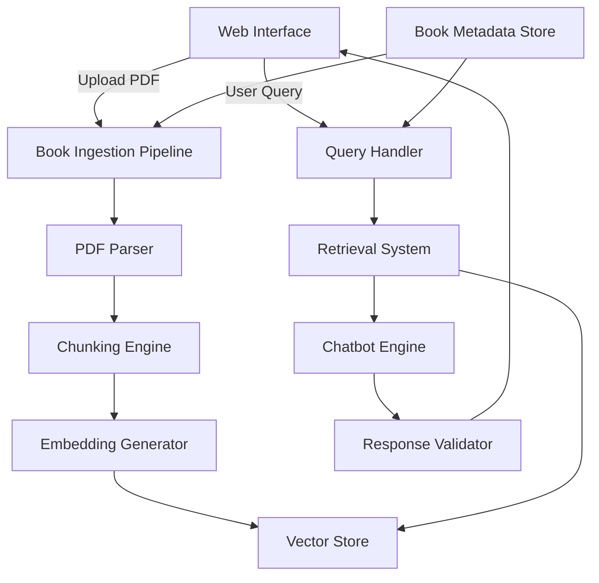

# Design Document: Book-Bounded Tutoring Chatbot

## Overview

The Book-Bounded Tutoring Chatbot is a web-based system that transforms uploaded PDF books into strictly bounded educational chatbots for children aged 4-15. The system enforces a retrieval-first architecture where all responses must originate exclusively from the uploaded book content, with explicit citations and hallucination prevention mechanisms.

The core design principle is **strict content boundaries**: the chatbot operates as a "closed-book" system that can only explain, rephrase, and cite content from the uploaded book. It cannot add external knowledge, examples, or facts. This ensures educational integrity and prevents misinformation.

### Key Design Decisions

1. **Retrieval-Augmented Generation (RAG) Architecture**: Use a retrieval-first approach where relevant book chunks are retrieved before response generation, ensuring all responses are grounded in book content.

2. **Embedding-Based Retrieval**: Use sentence embeddings for semantic search to find relevant chunks, supporting both English and Urdu queries.

3. **Chunk-Level Citations**: Every response includes explicit Chunk_IDs, allowing verification and traceability back to source content.

4. **Response Validation Layer**: Implement a post-generation validation step that checks responses against retrieved chunks to prevent hallucination.

5. **Zero-Cost Stack**: Use free, open-source tools and libraries (Python, sentence-transformers, PyPDF2, Flask/FastAPI, vanilla JS or React).

6. **Age-Adaptive Prompting**: Use prompt engineering to adjust language complexity based on user age, rather than fine-tuning separate models.

## Architecture

### System Components



### Component Responsibilities

1. **Web Interface**: Handles user interactions, file uploads, chat display, and citation rendering
2. **Book Ingestion Pipeline**: Orchestrates PDF processing, chunking, embedding generation, and storage
3. **PDF Parser**: Extracts text from PDF files, preserving Unicode characters (English and Urdu)
4. **Chunking Engine**: Divides book content into semantically coherent segments with metadata
5. **Embedding Generator**: Creates vector embeddings for chunks and queries
6. **Vector Store**: Stores and indexes chunk embeddings for fast similarity search
7. **Retrieval System**: Performs semantic search to find relevant chunks for queries
8. **Chatbot Engine**: Generates age-appropriate responses using only retrieved chunks
9. **Response Validator**: Verifies responses contain only content from retrieved chunks
10. **Book Metadata Store**: Tracks uploaded books, their processing status, and metadata

### Data Flow

**Book Upload Flow:**
1. User uploads PDF via Web Interface
2. PDF Parser extracts text and page numbers
3. Chunking Engine creates semantic chunks with metadata
4. Embedding Generator creates vector embeddings for each chunk
5. Chunks and embeddings stored in Vector Store
6. Book metadata stored in Book Metadata Store

**Query-Response Flow:**
1. User submits query via Web Interface
2. Query Handler validates input and retrieves user age preference
3. Embedding Generator creates query embedding
4. Retrieval System searches Vector Store for similar chunks
5. Top-k relevant chunks retrieved with Chunk_IDs
6. Chatbot Engine generates response using only retrieved chunks
7. Response Validator checks response against retrieved chunks
8. If valid, response with citations sent to Web Interface
9. If invalid, refusal message or regeneration triggered

## Components and Interfaces

### 1. PDF Parser

**Technology**: PyPDF2 or pdfplumber (Python libraries)

**Interface**:
```python
class PDFParser:
    def extract_text(pdf_path: str) -> List[PageContent]:
        """
        Extracts text from PDF file.
        
        Args:
            pdf_path: Path to PDF file
            
        Returns:
            List of PageContent objects containing text and page numbers
            
        Raises:
            PDFParseError: If PDF cannot be parsed or contains no text
            FileSizeError: If PDF exceeds 450 pages
        """
        pass
```

**Data Structure**:
```python
@dataclass
class PageContent:
    page_number: int
    text: str
    metadata: Dict[str, Any]  # e.g., {"has_images": bool, "language": str}
```

### 2. Chunking Engine

**Strategy**: Use a hybrid approach combining:
- Fixed-size chunking with overlap (baseline)
- Sentence boundary detection (avoid mid-sentence splits)
- Paragraph preservation where possible

**Interface**:
```python
class ChunkingEngine:
    def create_chunks(
        pages: List[PageContent],
        chunk_size: int = 500,
        overlap: int = 50
    ) -> List[Chunk]:
        """
        Creates semantic chunks from page content.
        
        Args:
            pages: List of PageContent objects
            chunk_size: Target chunk size in tokens
            overlap: Overlap between chunks in tokens
            
        Returns:
            List of Chunk objects with unique IDs and metadata
        """
        pass
```

**Data Structure**:
```python
@dataclass
class Chunk:
    chunk_id: str  # Format: "book_{book_id}_chunk_{index}"
    text: str
    page_numbers: List[int]
    start_char: int
    end_char: int
    metadata: Dict[str, Any]  # e.g., {"section": str, "language": str}
```

### 3. Embedding Generator

**Technology**: sentence-transformers library with multilingual models (e.g., `paraphrase-multilingual-MiniLM-L12-v2`)

**Interface**:
```python
class EmbeddingGenerator:
    def __init__(self, model_name: str):
        """Initialize with a sentence-transformers model."""
        pass
    
    def generate_embedding(text: str) -> np.ndarray:
        """
        Generates embedding vector for text.
        
        Args:
            text: Input text (English or Urdu)
            
        Returns:
            Embedding vector as numpy array
        """
        pass
    
    def generate_batch_embeddings(texts: List[str]) -> np.ndarray:
        """Generates embeddings for multiple texts efficiently."""
        pass
```

### 4. Vector Store

**Technology**: FAISS (Facebook AI Similarity Search) for local vector storage, or ChromaDB for simplicity

**Interface**:
```python
class VectorStore:
    def add_chunks(
        book_id: str,
        chunks: List[Chunk],
        embeddings: np.ndarray
    ) -> None:
        """
        Adds chunks and their embeddings to the store.
        
        Args:
            book_id: Unique identifier for the book
            chunks: List of Chunk objects
            embeddings: Corresponding embedding vectors
        """
        pass
    
    def search(
        book_id: str,
        query_embedding: np.ndarray,
        top_k: int = 5,
        min_similarity: float = 0.3
    ) -> List[Tuple[Chunk, float]]:
        """
        Searches for similar chunks.
        
        Args:
            book_id: Book to search within
            query_embedding: Query vector
            top_k: Number of results to return
            min_similarity: Minimum similarity threshold
            
        Returns:
            List of (Chunk, similarity_score) tuples
        """
        pass
    
    def delete_book(book_id: str) -> None:
        """Removes all chunks for a book."""
        pass
```

### 5. Retrieval System

**Interface**:
```python
class RetrievalSystem:
    def __init__(
        self,
        embedding_generator: EmbeddingGenerator,
        vector_store: VectorStore
    ):
        pass
    
    def retrieve_chunks(
        book_id: str,
        query: str,
        top_k: int = 5
    ) -> List[Chunk]:
        """
        Retrieves relevant chunks for a query.
        
        Args:
            book_id: Book to search within
            query: User query (English or Urdu)
            top_k: Number of chunks to retrieve
            
        Returns:
            List of relevant Chunk objects, ranked by relevance
        """
        pass
```

### 6. Chatbot Engine

**Technology**: Use a free LLM API (e.g., Ollama with local models, or Hugging Face Inference API with free models)

**Interface**:
```python
class ChatbotEngine:
    def generate_response(
        query: str,
        retrieved_chunks: List[Chunk],
        user_age: int,
        language: str = "en"
    ) -> Response:
        """
        Generates a bounded response using only retrieved chunks.
        
        Args:
            query: User's question
            retrieved_chunks: Chunks retrieved from the book
            user_age: User's age (4-15) for language adaptation
            language: Response language ("en" or "ur")
            
        Returns:
            Response object containing answer and citations
        """
        pass
    
    def generate_refusal(
        query: str,
        user_age: int,
        language: str = "en"
    ) -> Response:
        """
        Generates a polite refusal message when no relevant chunks found.
        
        Args:
            query: User's question
            user_age: User's age for age-appropriate language
            language: Response language
            
        Returns:
            Response object with refusal message
        """
        pass
```

**Prompt Engineering Strategy**:
```python
def build_prompt(query: str, chunks: List[Chunk], age: int) -> str:
    """
    Constructs a prompt that enforces bounded responses.
    
    Template structure:
    1. System instruction: "You are a tutor. Answer ONLY using the provided book excerpts."
    2. Age adaptation: "Explain for a {age}-year-old child."
    3. Constraints: "Do not add external knowledge. Cite chunk IDs."
    4. Book excerpts: Include chunk text with IDs
    5. User query
    """
    age_guidance = {
        (4, 7): "Use very simple words and short sentences.",
        (8, 11): "Use clear language appropriate for elementary students.",
        (12, 15): "Use age-appropriate language for middle school students."
    }
    
    # Build prompt with constraints and chunks
    # ...
```

### 7. Response Validator

**Interface**:
```python
class ResponseValidator:
    def validate_response(
        response: Response,
        retrieved_chunks: List[Chunk]
    ) -> ValidationResult:
        """
        Validates that response content originates from retrieved chunks.
        
        Args:
            response: Generated response
            retrieved_chunks: Chunks used for generation
            
        Returns:
            ValidationResult indicating if response is valid
        """
        pass
    
    def check_hallucination(
        response_text: str,
        chunk_texts: List[str]
    ) -> bool:
        """
        Checks if response contains content not in chunks.
        
        Uses heuristics:
        - Keyword extraction and matching
        - Sentence similarity comparison
        - Named entity checking
        
        Returns:
            True if hallucination detected, False otherwise
        """
        pass
```

**Data Structure**:
```python
@dataclass
class ValidationResult:
    is_valid: bool
    confidence: float
    issues: List[str]  # List of detected problems
```

### 8. Web Interface

**Technology**: React (or vanilla HTML/CSS/JS for simplicity)

**Key UI Components**:
1. **Book Upload Panel**: File input, upload button, processing status
2. **Book Selector**: Dropdown to select active book
3. **Age Input**: Number input or slider (4-15)
4. **Chat Window**: Message list with user/bot messages
5. **Message Input**: Text area with send button
6. **Citation Display**: Expandable sections showing chunk content

**API Endpoints** (Backend):
```python
# Book management
POST /api/books/upload          # Upload PDF
GET  /api/books                 # List uploaded books
DELETE /api/books/{book_id}     # Delete book

# Chat
POST /api/chat                  # Send message
GET  /api/chat/history/{book_id}  # Get chat history

# Chunks (for citation viewing)
GET  /api/chunks/{chunk_id}     # Get chunk content
```

## Data Models

### Database Schema

**Books Table**:
```sql
CREATE TABLE books (
    book_id VARCHAR(36) PRIMARY KEY,
    title VARCHAR(255) NOT NULL,
    filename VARCHAR(255) NOT NULL,
    upload_date TIMESTAMP DEFAULT CURRENT_TIMESTAMP,
    page_count INTEGER NOT NULL,
    processing_status VARCHAR(50) NOT NULL,  -- 'pending', 'processing', 'completed', 'failed'
    language VARCHAR(10),  -- 'en', 'ur', 'mixed'
    metadata JSON
);
```

**Chunks Table**:
```sql
CREATE TABLE chunks (
    chunk_id VARCHAR(100) PRIMARY KEY,
    book_id VARCHAR(36) NOT NULL,
    text TEXT NOT NULL,
    page_numbers JSON NOT NULL,  -- Array of page numbers
    start_char INTEGER NOT NULL,
    end_char INTEGER NOT NULL,
    metadata JSON,
    FOREIGN KEY (book_id) REFERENCES books(book_id) ON DELETE CASCADE
);
```

**Chat Sessions Table** (optional, for history):
```sql
CREATE TABLE chat_sessions (
    session_id VARCHAR(36) PRIMARY KEY,
    book_id VARCHAR(36) NOT NULL,
    user_age INTEGER NOT NULL,
    created_at TIMESTAMP DEFAULT CURRENT_TIMESTAMP,
    FOREIGN KEY (book_id) REFERENCES books(book_id) ON DELETE CASCADE
);
```

**Messages Table** (optional, for history):
```sql
CREATE TABLE messages (
    message_id VARCHAR(36) PRIMARY KEY,
    session_id VARCHAR(36) NOT NULL,
    role VARCHAR(10) NOT NULL,  -- 'user' or 'assistant'
    content TEXT NOT NULL,
    chunk_ids JSON,  -- Array of chunk IDs used (for assistant messages)
    timestamp TIMESTAMP DEFAULT CURRENT_TIMESTAMP,
    FOREIGN KEY (session_id) REFERENCES chat_sessions(session_id) ON DELETE CASCADE
);
```

### In-Memory Data Structures

**Response Object**:
```python
@dataclass
class Response:
    text: str
    chunk_ids: List[str]
    is_refusal: bool
    metadata: Dict[str, Any]  # e.g., {"language": str, "age_group": str}
```

**Query Context**:
```python
@dataclass
class QueryContext:
    query: str
    book_id: str
    user_age: int
    language: str
    session_id: Optional[str] = None
```


## Correctness Properties

*A property is a characteristic or behavior that should hold true across all valid executions of a system—essentially, a formal statement about what the system should do. Properties serve as the bridge between human-readable specifications and machine-verifiable correctness guarantees.*

### Property 1: PDF Size Validation

*For any* PDF file, if the file has 450 pages or fewer, the Book_Ingestion_Pipeline should accept it; if the file has more than 450 pages, the system should reject it with an error message.

**Validates: Requirements 1.1, 1.6**

### Property 2: Multilingual Text Extraction Preservation

*For any* PDF file containing English and/or Urdu text, the extracted text should preserve all characters correctly, such that the extracted content matches the original text when compared character-by-character.

**Validates: Requirements 1.2**

### Property 3: Automatic Chunking

*For any* extracted book text, the Chunking_Engine should create chunks without requiring manual configuration or intervention.

**Validates: Requirements 1.3**

### Property 4: Chunk ID Uniqueness

*For any* set of chunks created from a book, all Chunk_IDs should be unique within that book.

**Validates: Requirements 1.4**

### Property 5: Chunk Storage and Retrieval Round-Trip

*For any* chunk stored in the system, retrieving it by its Chunk_ID should return the same chunk with identical text and metadata.

**Validates: Requirements 1.5**

### Property 6: Semantic Boundary Preservation

*For any* chunk created by the Chunking_Engine, the chunk should not split mid-sentence (i.e., chunk boundaries should align with sentence boundaries or paragraph boundaries).

**Validates: Requirements 2.2**

### Property 7: Chunk Metadata Completeness

*For any* chunk created, it should have all required metadata fields populated, including page_numbers, start_char, end_char, and chunk_id.

**Validates: Requirements 2.3**

### Property 8: Multilingual Query Retrieval

*For any* query in English or Urdu and any book, the Retrieval_System should return a ranked list of chunks (possibly empty if no relevant chunks exist above the threshold).

**Validates: Requirements 3.1, 3.2**

### Property 9: Retrieval Result Ranking

*For any* non-empty retrieval result, the chunks should be ordered by descending relevance score (i.e., result[i].score >= result[i+1].score for all i).

**Validates: Requirements 3.3**

### Property 10: Top-K Retrieval Limit

*For any* query, the Retrieval_System should return at most K chunks, where K is the specified top_k parameter.

**Validates: Requirements 3.4**

### Property 11: Bounded Response Content

*For any* response generated by the Chatbot_Engine, all factual content in the response should be traceable to the retrieved chunks (verified by the Response_Validator).

**Validates: Requirements 4.1**

### Property 12: Response Citation Requirement

*For any* non-refusal response, the response should include at least one Chunk_ID citation.

**Validates: Requirements 4.3**

### Property 13: Refusal Message Purity

*For any* refusal message generated when no relevant chunks are found, the message should not contain factual claims or answers to the query.

**Validates: Requirements 4.5**

### Property 14: Response Validation Enforcement

*For any* response, the Response_Validator should check it against retrieved chunks before the response is sent to the user.

**Validates: Requirements 6.1**

### Property 15: Hallucination Detection

*For any* response containing content not found in the retrieved chunks, the Response_Validator should reject the response.

**Validates: Requirements 6.2**

### Property 16: Validation Failure Recovery

*For any* response rejected by the Response_Validator, the system should either generate a new response or display a refusal message (not display the invalid response).

**Validates: Requirements 6.3**

### Property 17: Rejected Response Logging

*For any* response rejected by the Response_Validator, an entry should be created in the system logs containing the response, reason for rejection, and timestamp.

**Validates: Requirements 6.4**

### Property 18: Age Preference Persistence

*For any* user age input (4-15), the system should store the age and retrieve the same value when generating subsequent responses in that session.

**Validates: Requirements 7.1**

### Property 19: Cross-Language Retrieval Parity

*For any* semantically equivalent queries in English and Urdu, the retrieval results should have comparable relevance scores and return similar chunks.

**Validates: Requirements 8.4**

### Property 20: Response Language Matching

*For any* query in language L (English or Urdu), the generated response should be in the same language L.

**Validates: Requirements 8.5**

### Property 21: Citation Display in UI

*For any* response with Chunk_IDs, the Web_Interface rendering function should include all Chunk_IDs in the displayed output.

**Validates: Requirements 5.1**

### Property 22: User Message Display

*For any* message sent by the user, the Web_Interface should add the message to the conversation view immediately after sending.

**Validates: Requirements 9.3**

### Property 23: Multilingual UI Support

*For any* text input containing Urdu characters, the Web_Interface should correctly display the text without character corruption or rendering errors.

**Validates: Requirements 9.5**

### Property 24: Processing Indicator Display

*For any* query being processed, the Web_Interface should display a loading or processing indicator until the response is received.

**Validates: Requirements 9.7**

### Property 25: Sequential Multi-Book Upload

*For any* sequence of N book uploads, each book should be processed successfully and independently, resulting in N separate books in the system.

**Validates: Requirements 11.1**

### Property 26: Book Processing Isolation

*For any* two books A and B, uploading book B should not modify, delete, or affect the chunks or metadata of book A.

**Validates: Requirements 11.2**

### Property 27: Book-Specific Chunk Isolation

*For any* book, the chunks stored for that book should not include chunks from any other book.

**Validates: Requirements 11.4**

### Property 28: Query-Book Binding

*For any* query with book B selected, the Retrieval_System should only return chunks that belong to book B (no chunks from other books).

**Validates: Requirements 11.5**

### Property 29: Comprehensive Refusal Message

*For any* refusal message, it should: (1) explain that the answer is not in the book, (2) not suggest external resources, and (3) encourage asking different questions about the book.

**Validates: Requirements 12.2, 12.4, 12.5**

## Error Handling

### Error Categories

1. **Input Validation Errors**
   - Oversized PDF files (> 450 pages)
   - Corrupted or unreadable PDF files
   - Empty PDF files (no extractable text)
   - Invalid file formats (non-PDF)

2. **Processing Errors**
   - PDF parsing failures
   - Chunking failures (e.g., text too short)
   - Embedding generation failures
   - Vector store connection failures

3. **Query Errors**
   - Empty queries
   - Queries in unsupported languages
   - Queries for non-existent books

4. **Response Generation Errors**
   - LLM API failures or timeouts
   - Response validation failures (hallucination detected)
   - Citation extraction failures

### Error Handling Strategies

**PDF Upload Errors**:
```python
try:
    validate_pdf(file)
    pages = pdf_parser.extract_text(file)
except FileSizeError as e:
    return {"error": "PDF exceeds 450 pages", "max_pages": 450}
except PDFParseError as e:
    return {"error": "Cannot read PDF file", "details": str(e)}
except NoTextError as e:
    return {"error": "PDF contains no extractable text"}
```

**Query Processing Errors**:
```python
try:
    chunks = retrieval_system.retrieve_chunks(book_id, query)
    if not chunks:
        return chatbot_engine.generate_refusal(query, user_age)
    response = chatbot_engine.generate_response(query, chunks, user_age)
    validation = response_validator.validate_response(response, chunks)
    if not validation.is_valid:
        logger.warning(f"Response validation failed: {validation.issues}")
        return chatbot_engine.generate_refusal(query, user_age)
    return response
except BookNotFoundError:
    return {"error": "Selected book not found"}
except RetrievalError as e:
    return {"error": "Failed to search book content", "details": str(e)}
except LLMError as e:
    return {"error": "Failed to generate response", "details": str(e)}
```

**Graceful Degradation**:
- If LLM API is unavailable, return a system error message (not a hallucinated response)
- If validation fails repeatedly, log the issue and return a refusal message
- If embedding generation fails, fall back to keyword-based search (if implemented)

## Testing Strategy

### Dual Testing Approach

This system requires both **unit tests** and **property-based tests** for comprehensive coverage:

- **Unit tests**: Verify specific examples, edge cases, and error conditions
- **Property tests**: Verify universal properties across all inputs using randomized testing

Both approaches are complementary and necessary. Unit tests catch concrete bugs in specific scenarios, while property tests verify general correctness across a wide input space.

### Property-Based Testing Configuration

**Library Selection**:
- **Python**: Use `hypothesis` library for property-based testing
- **JavaScript/TypeScript**: Use `fast-check` library

**Test Configuration**:
- Each property test must run a minimum of 100 iterations (due to randomization)
- Each property test must include a comment tag referencing the design document property
- Tag format: `# Feature: book-bounded-tutor, Property {number}: {property_text}`

**Example Property Test Structure**:
```python
from hypothesis import given, strategies as st
import pytest

# Feature: book-bounded-tutor, Property 4: Chunk ID Uniqueness
@given(st.lists(st.text(min_size=100, max_size=1000), min_size=5, max_size=50))
def test_chunk_id_uniqueness(texts):
    """For any set of chunks created from a book, all Chunk_IDs should be unique."""
    chunking_engine = ChunkingEngine()
    pages = [PageContent(i, text, {}) for i, text in enumerate(texts)]
    chunks = chunking_engine.create_chunks(pages)
    
    chunk_ids = [chunk.chunk_id for chunk in chunks]
    assert len(chunk_ids) == len(set(chunk_ids)), "Chunk IDs must be unique"
```

### Unit Testing Focus Areas

Unit tests should focus on:

1. **Specific Examples**:
   - Test PDF parsing with a known sample PDF
   - Test chunking with a specific book excerpt
   - Test retrieval with known query-chunk pairs

2. **Edge Cases**:
   - Empty queries
   - Single-word queries
   - Very long queries (> 500 characters)
   - PDFs with exactly 450 pages (boundary)
   - PDFs with mixed English and Urdu text
   - Chunks at page boundaries

3. **Error Conditions**:
   - Corrupted PDF files
   - Invalid book IDs
   - Network failures (mocked)
   - LLM API timeouts (mocked)

4. **Integration Points**:
   - End-to-end flow: upload → chunk → retrieve → respond
   - Database operations (CRUD for books and chunks)
   - API endpoint responses

### Property Test Coverage

Each correctness property (Property 1-29) should have a corresponding property-based test:

- **Property 1**: Generate random PDFs with varying page counts
- **Property 4**: Generate random text inputs and verify chunk ID uniqueness
- **Property 5**: Generate random chunks, store them, retrieve them, verify equality
- **Property 9**: Generate random queries and verify result ordering
- **Property 11**: Generate random responses and verify content traceability
- **Property 20**: Generate random queries in English/Urdu and verify response language

### Test Data Generation

**For Property Tests**:
- Use `hypothesis` strategies to generate random PDFs, text, queries
- Generate multilingual text (English and Urdu) using Unicode ranges
- Generate edge cases automatically (empty strings, very long strings, special characters)

**For Unit Tests**:
- Use fixture files (sample PDFs, known book excerpts)
- Create mock objects for external dependencies (LLM API, vector store)
- Use deterministic test data for reproducibility

### Testing Hallucination Prevention

This is critical for the system's core requirement. Testing approach:

1. **Property Test**: Generate responses with known hallucinated content and verify the validator rejects them
2. **Unit Test**: Create specific examples of hallucinated responses and verify rejection
3. **Integration Test**: Run end-to-end queries and manually verify responses are bounded
4. **Monitoring**: Log all validation failures in production for continuous improvement

### Test Execution

```bash
# Run all tests
pytest tests/

# Run only property tests
pytest tests/ -m property

# Run only unit tests
pytest tests/ -m unit

# Run with coverage
pytest tests/ --cov=src --cov-report=html
```

### Continuous Testing

- Run tests on every commit (CI/CD pipeline)
- Monitor property test failure rates
- Track validation rejection rates in production
- Periodically review logged rejected responses for patterns

